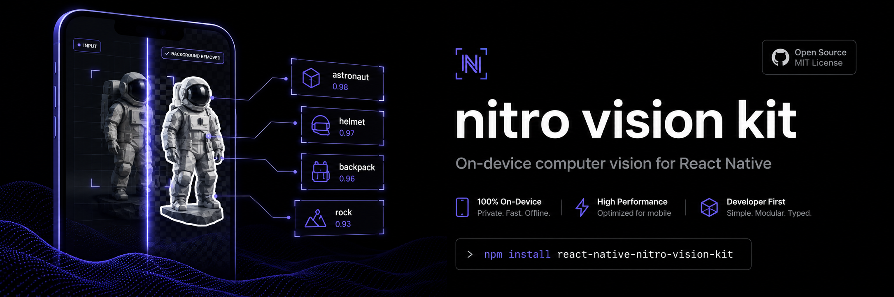
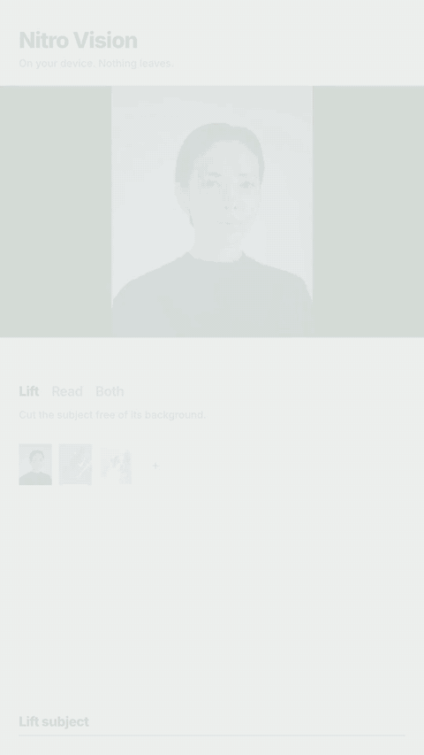

<div align="center">
  
</div>

<div align="center">
  <p>
    <a href="https://www.npmjs.com/package/react-native-nitro-vision-kit"></a>
    <a href="https://github.com/sagawrr/react-native-nitro-vision-kit/actions/workflows/ci.yml"></a>
    <a href="./LICENSE"></a>
  </p>
  <p>
    Cutouts · Labels · OCR — <a href="https://developer.apple.com/documentation/vision">Vision</a> on iOS,
    <a href="https://developers.google.com/ml-kit">ML Kit</a> on Android, built with
    <a href="https://nitro.margelo.com">Nitro Modules</a>.
  </p>
</div>

## Features

<table>
<tr>
<td width="60%" valign="middle">
<b><code>removeBackground</code></b><br/>
Subject cutout — trim, export PNG/JPEG, optional mask<br/><br/>
<b><code>classifyImage</code></b><br/>
Ranked labels — offline on both platforms<br/><br/>
<b><code>readText</code></b><br/>
OCR — Latin / CJK / Devanagari on Android; Vision on iOS 18+<br/><br/>
<b><code>analyzeImage</code></b><br/>
All three from a single decode<br/><br/>
<sub>Cutout and OCR results live on the native side until you export them. Call <code>dispose()</code> when done.</sub>
</td>
<td width="40%" valign="middle">

</td>
</tr>
</table>

## Install

```bash
npm install react-native-nitro-vision-kit react-native-nitro-modules
cd ios && pod install
```

| | Minimum |
| --- | --- |
| React Native | 0.75 |
| [`react-native-nitro-modules`](https://nitro.margelo.com) | 0.36.0 |
| iOS | 13 · cutouts **17+** · OCR **18+** |
| Android | API 24 |

Requires the New Architecture.

## Usage

```ts
import { VisionKit } from 'react-native-nitro-vision-kit'
```

Cutout:

```ts
if (!VisionKit.capabilities.supportsBackgroundRemoval) {
  throw new Error(VisionKit.capabilities.backgroundRemovalUnavailableReason)
}

const cutout = await VisionKit.removeBackground(imagePath, { trim: true })
const path = await cutout.saveToTemporaryFile('png', 100)
cutout.dispose()
```

Labels:

```ts
const labels = await VisionKit.classifyImage(imagePath, {
  maxResults: 5,
  minConfidence: 0.5,
})
```

OCR:

```ts
const ocr = await VisionKit.readText(imagePath)
console.log(ocr.text)
ocr.dispose()
```

All three at once:

```ts
const result = await VisionKit.analyzeImage(imagePath, {
  removeBackground: { trim: true },
  classify: { maxResults: 5 },
  readText: {},
})

result.segmentation?.dispose()
result.text?.dispose()
```

## API

### Capabilities

`VisionKit.capabilities`

| Field | Meaning |
| --- | --- |
| `supportsBackgroundRemoval` | Cutouts available |
| `backgroundRemovalUnavailableReason` | Why not |
| `supportsImageClassification` | Labels available |
| `supportsTextRecognition` | OCR available |
| `supportedTextLanguages` | Language tags you can request |

### `removeBackground(path, options?)`

Returns a cutout HybridObject. iOS 17+, Android API 24+ with Play Services (ML Kit subject segmentation, beta).

Export via `saveToTemporaryFile(format, quality)`, `toArrayBuffer()`, or `toMaskBuffer()`.

<details>
<summary>Options &amp; result fields</summary>

| Option | Default | Meaning |
| --- | --- | --- |
| `trim` | `true` | Crop to the subject |
| `maxPixels` | `6_000_000` | Cap when loading the image |
| `retainMask` | `false` | Keep mask for `toMaskBuffer()` |

Result: `width`, `height`, `bounds` (`VisionRect`, 0–1), `pixelBounds`, `foregroundCoverage`, `centroid`, `instanceCount`, `hasMask`, `sourceWidth`, `sourceHeight`, `trimOrigin`.

</details>

### `classifyImage(path, options?)`

Returns `{ label, confidence, index }[]`, highest confidence first. iOS 13+; on Android the model ships with the library.

<details>
<summary>Options</summary>

| Option | Default | Meaning |
| --- | --- | --- |
| `maxResults` | `0` | `0` keeps all above the score floor |
| `minConfidence` | `0.5` | Lowest score to keep |
| `region` | full image | `VisionRect` (0–1) |

</details>

### `readText(path, options?)`

Returns a text HybridObject. Prefer `text` and `blockAt(i)` — `blocks` copies everything into JS. iOS 18+ (`RecognizeTextRequest`); Android uses Play Services script models (Latin, Chinese, Japanese, Korean, Devanagari).

Image load cap: 4M pixels on both platforms; on Android the longest side is also capped at 2048.

<details>
<summary>Options &amp; platform quirks</summary>

| Option | Default | Platform |
| --- | --- | --- |
| `languages` | auto / Latin | Both |
| `recognitionLevel` | `accurate` | iOS |
| `region` | full image | Both (`VisionRect`) |
| `minTextHeightFraction` | unset | Both |
| `usesLanguageCorrection` | `true` | iOS |
| `customWords` | unset | iOS |
| `maxCandidates` | `1` | iOS (`1`–`10`) |

Android: `languages` selects script models. Non-Latin models also read Latin; multiple non-Latin scripts can run together. A block may contain many lines.

iOS: each block is one line.

</details>

### `analyzeImage(path, options)`

One decode. Pass at least one of `removeBackground`, `classify`, or `readText`.

- No subject found → `segmentation` omitted; labels and text still run.
- If classify/OCR omit `region` and a cutout ran → subject bounds are used.

## Platform notes

### Model download (Android)

`classifyImage` works offline out of the box (model is packaged). `removeBackground` and `readText` download a Play Services model once — allow up to ~2 minutes online on first use; offline with no model fails immediately. iOS ships its models with the OS.

### Paths

Absolute paths and `file://` work everywhere. `content://` is Android-only.

Only pass paths created by your app — native code opens the path and returns pixels/text to JavaScript.

## Example

```bash
cd example
npm install
cd ios && bundle install && bundle exec pod install && cd ..
npm run ios    # or: npm run android
```

After a cutout, **Keep** saves to Photos.

## License

[MIT](./LICENSE) · [Security](./SECURITY.md) · [Changelog](./CHANGELOG.md)
